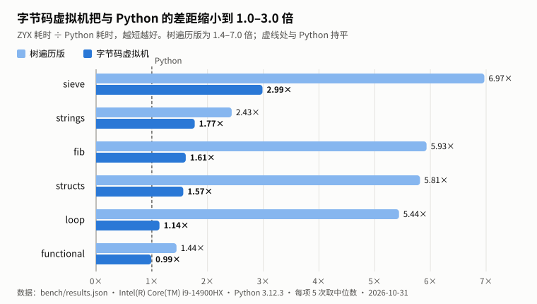

# ZYX 语言

ZYX 是一门用 Rust 实现的解释型通用脚本语言。它采用花括号语法和动态类型，提供树遍历与字节码虚拟机两个执行后端，支持中英文关键字。

```zyx
struct Student { name, score }

函数 等级(分) {
    匹配 分 {
        90..=100 => "优",
        60..90 => "良",
        _ => "差",
    }
}

let students = [Student("小明", 95), Student("小红", 72), Student("小刚", 40)]
let ranked = students |> sort(fn(s) => -s.score)
for i, s in ranked {
    print("{i + 1}. {s.name}：{等级(s.score)}")
}
```

语言特色：

- **管道** `|>` 与**统一调用语法**：`xs |> filter(f) |> sort()`，`a.f(b)` 就是 `f(a, b)`。
- **字符串插值** `"{表达式}"`，**块表达式**：块的最后一个表达式就是它的值。
- **`match`** 支持字面量、区间、`|` 多选、变量绑定和 `if` 守卫。
- **结构体**用调用语法构造 `Point(1, 2)` / `Point(x: 1)`，方法写在 `impl` 中。
- **中英文关键字**（`如果` / `if`、`函数` / `fn` 等）可以混用。
- **严格布尔条件**：`if` 只接受 `true` / `false`，杜绝隐式真值转换带来的隐蔽错误。

## 快速开始

需要较新的稳定版 Rust（开发使用 1.97）和 Python 3（测试与性能脚本使用）。

```sh
make build                                  # 编译解释器 → target/release/zyx
./target/release/zyx examples/app/2048.zyx  # 运行 2048 游戏
make test                                   # 运行全部测试
make bench                                  # 运行性能测试并与 Python 对比
```

命令行：`zyx [--backend tree|vm] [--ast | --dis] <文件.zyx>`。默认使用树遍历后端；`--backend vm` 使用字节码虚拟机，结果相同但更快；`--ast` / `--dis` 分别打印语法树和字节码。

## 作业提交物

| 提交物 | 位置 | 说明 |
|---|---|---|
| 1. 语法规则文档 | [`docs/reference.md`](docs/reference.md) | 完整的词法、类型、表达式、语句、内置函数、错误规则，附 EBNF 语法与示例程序 |
| 2. 解释器源程序 | [`src/`](src/) | 约 7200 行 Rust，零第三方依赖；结构见下文 |
| 3. 黑盒测试集 | [`tests/zyx/`](tests/zyx/) | 104 个 ZYX 测试脚本，覆盖全部语言功能与各类错误；在两个后端上各运行一遍。`make test` 一条命令执行全部测试（另含 19 个 Rust 单元测试和 2048 自测） |
| 4. 性能测试报告 | [`docs/performance-report.md`](docs/performance-report.md) | 6 组 ZYX / Python 对照用例，虚拟机耗时为 CPython 3.12 的 0.99 到 2.99 倍；含三轮优化过程与原因分析 |
| 5. 开发指南 | [`docs/guide.md`](docs/guide.md) | 面向人：构建、循序渐进的教程、调试、测试、项目结构 |
| 5. 给 AI 使用的文档 | [`.claude/skills/zyx/SKILL.md`](.claude/skills/zyx/SKILL.md) | 面向编程 Agent：易错点、速查、内置函数、示例、自查清单。有效性验证见 [`docs/notes/skill-validation/`](docs/notes/skill-validation/) |
| 6. 编程 Agent 开发的应用程序 | [`examples/app/2048.zyx`](examples/app/2048.zyx) | 终端 2048，385 行有效代码；任务说明见 [`PROMPT.md`](examples/app/PROMPT.md) |
| 6. 编程 Agent 生成的开发记录 | [`examples/app/DEVLOG.md`](examples/app/DEVLOG.md) | 开发 Agent 边做边记的开发日志，与 5 次功能提交一一对应 |



## 测试

```sh
make test                                     # 单元测试 + 黑盒测试（tree、vm）+ 2048 自测
make test BACKENDS=vm                         # 只测虚拟机后端
python3 tests/run_tests.py --backend vm match # 只运行路径中含 match 的测试
```

黑盒测试是普通的 ZYX 程序，期望结果写在注释里（`# expect:`、`# expect-error:`、`# expect-exit:`、`# stdin:`），由 [`tests/run_tests.py`](tests/run_tests.py) 运行并比对。

| 类别 | 数量 | 类别 | 数量 |
|---|---|---|---|
| 语法错误 `syntax/` | 27 | 运行时错误 `errors/` | 40 |
| 基础 `basics/` | 7 | 控制流 `control/` | 5 |
| 函数与闭包 `functions/` | 5 | 数组 `arrays/` | 5 |
| 内置函数 `builtins/` | 5 | 字符串 `strings/` | 3 |
| 输入输出 `io/` | 3 | 结构体 `structs/` | 2 |
| 中文关键字 `chinese/` | 2 | | |

## 项目结构

```text
src/        词法分析 → 语法分析 → 槽位解析 → 树遍历解释器 / 字节码编译器 + 虚拟机
tests/      黑盒测试与运行器
bench/      性能测试用例（ZYX 与 Python 对照）、运行脚本与各轮优化的历史数据
docs/       语法规格、开发指南、性能报告、PRD、架构决策记录（adr/）、验证记录（notes/）
examples/   编程 Agent 开发的 2048 应用及其开发日志
.claude/    给编程 Agent 的 ZYX 技能文档
```

设计决策记录在 [`docs/adr/`](docs/adr/)，项目规划见 [`docs/PRD.md`](docs/PRD.md)。
